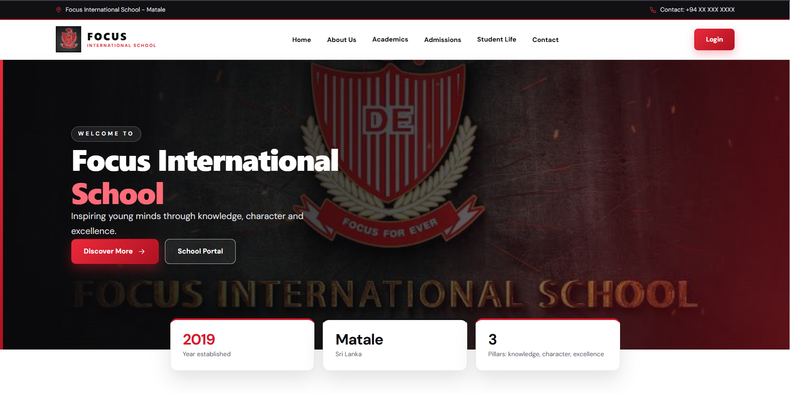
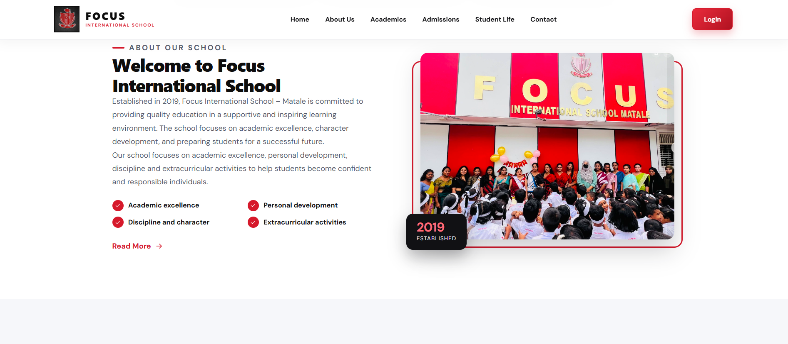
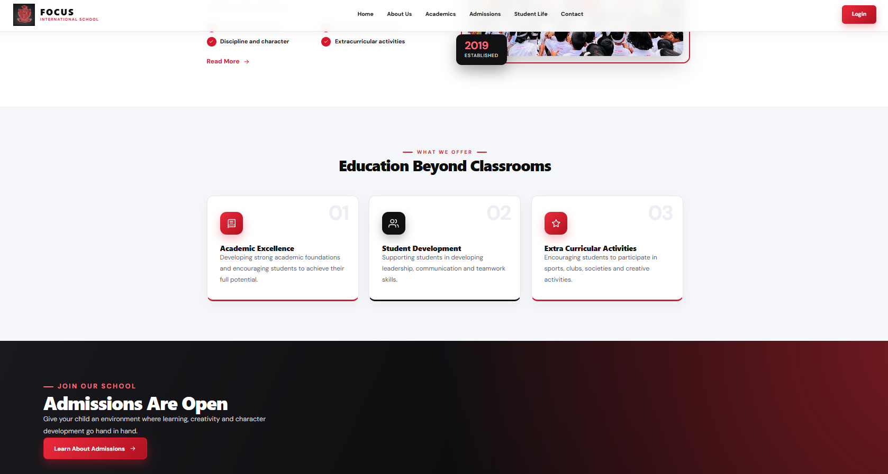
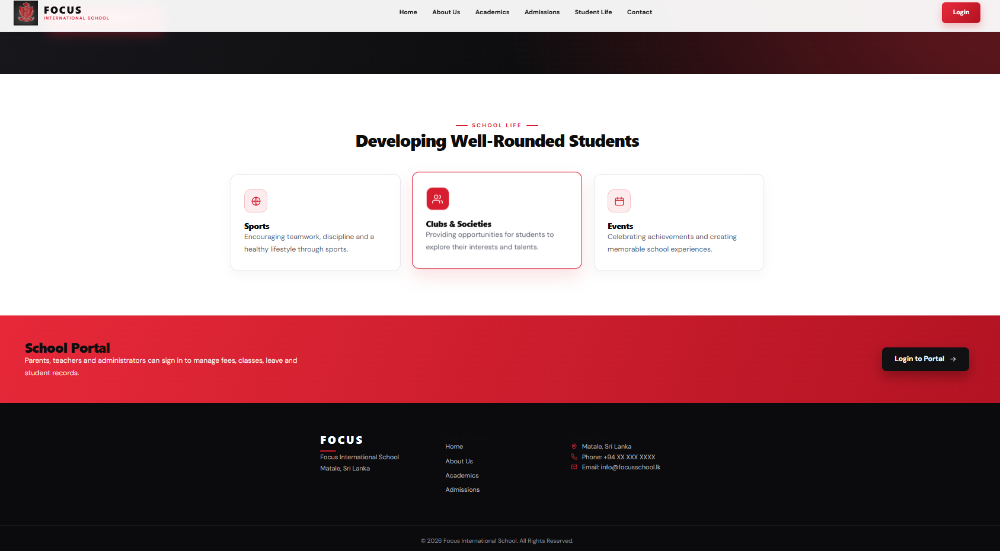
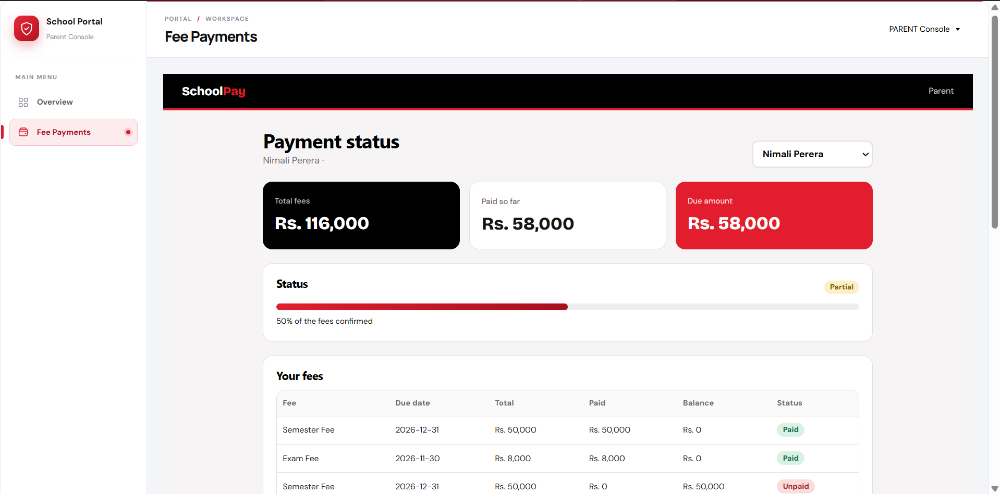
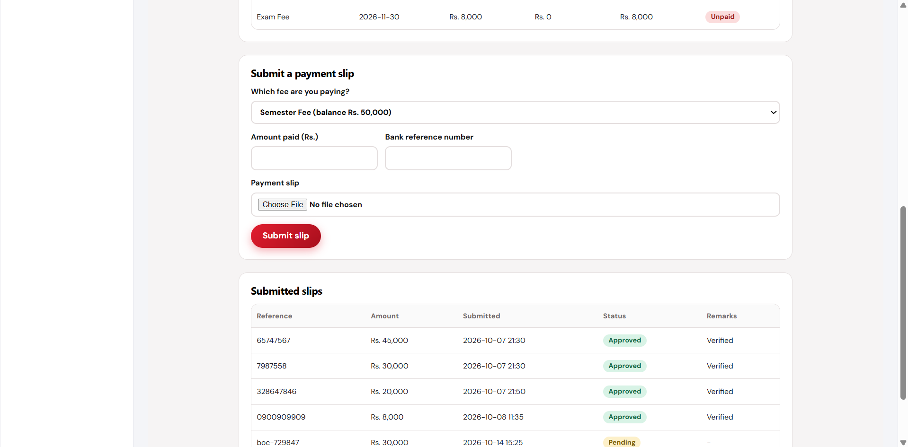
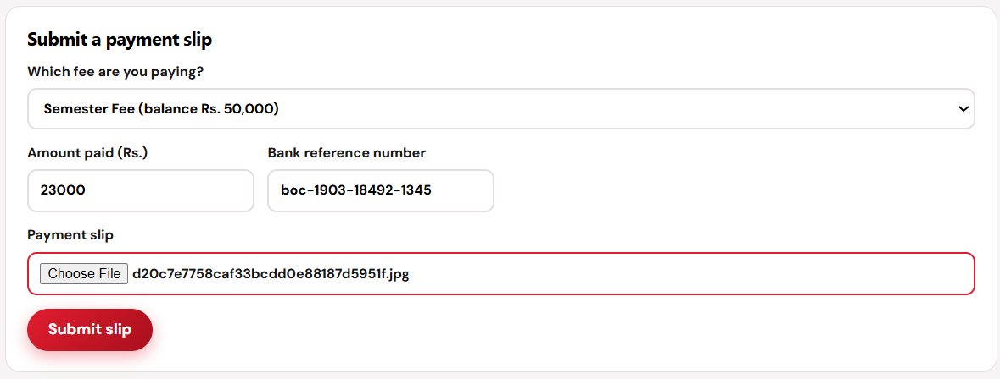
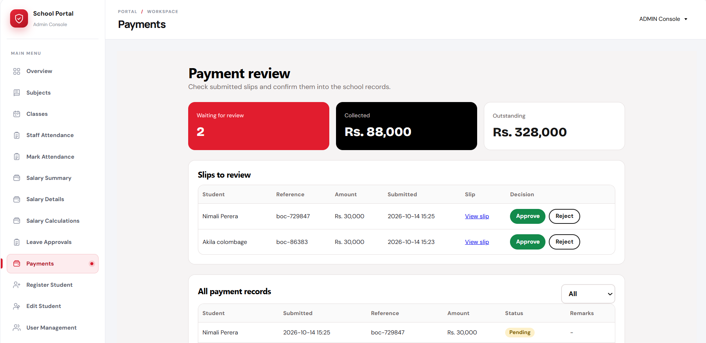
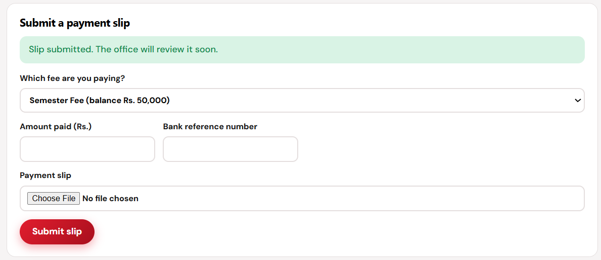

# School Management System: Payment Management Module

A Java-based web module that computerizes a school's manual fee payment process. Parents can submit payment slips online and track their child's payment status, while administrators verify the slips and record approved payments in the school database.

This repository contains **only the payment management component** of a 5-member group project (SE2012-Object-Oriented Analysis and Design | Y2S1 | final project). It was designed and developed by me as part of the larger School Management System.

---

## Table of Contents

- [Features](#features)
- [User Roles](#user-roles)
- [Tech Stack](#tech-stack)
- [Project Structure](#project-structure)
- [Database Design](#database-design)
- [Getting Started](#getting-started)
- [Usage](#usage)
- [UI Theme](#ui-theme)
- [Screenshots](#screenshots)
- [Future Improvements](#future-improvements)
- [Author](#author)

---

## Features

### 1. Student Payment Status
- Shows whether a student's payment is **Paid** or **Pending**.
- For pending payments, displays the **amount already paid** and the **remaining due amount**.

### 2. Payment Slip Submission
- Parents can upload a payment slip (image or PDF) for a specific student and fee.
- Each submission is stored with a status of `PENDING`, `APPROVED`, or `REJECTED`.
- Parents can see the review result of each submitted slip.

### 3. Student Payment Record Viewing
- Parents can view the full payment history of their child.
- Administrators can view and search payment records for all students.
- Administrators review submitted slips, **approve or reject** them, and approved payments are saved to the school database and reflected in the student's payment status.

---

## User Roles

| Role | Capabilities |
|------|--------------|
| **Parent** | Upload payment slips, view payment status (paid / pending, amount paid, amount due), view payment history |
| **Administrator** | Review submitted slips, approve or reject them, add and manage student payment records, view all payment records |

---

## Tech Stack

| Layer | Technology |
|-------|------------|
| Backend | Java, Spring Boot (REST API) |
| Security | Spring Security, JWT authentication |
| Frontend | HTML, CSS, JavaScript (update with your framework, e.g. React) |
| Database | MySQL (JDBC DAOs and Spring Data repositories) |
| Build tool | Maven |
| IDE | IntelliJ IDEA |
| Version control | Git & GitHub |

-------|------------|
| Backend | Java (e.g. Servlets / Spring Boot) |
| Frontend | HTML, CSS, JavaScript (e.g. JSP / Thymeleaf) |
| Database | MySQL |
| Build tool | Maven / Gradle |
| IDE | IntelliJ IDEA |
| Version control | Git & GitHub |

---

## Project Structure

### Full project structure (entire School Management System)

The complete system is built by the whole team. This is the overall layout of the backend:

```
smart-student-management-system/
└── backend/
    ├── db/                                  # Database scripts
    ├── src/
    │   ├── main/
    │   │   ├── java/
    │   │   │   ├── com.studentmanagement.backend/
    │   │   │   │   ├── config/
    │   │   │   │   │   ├── DatabaseConnection
    │   │   │   │   │   ├── JwtAuthFilter
    │   │   │   │   │   ├── JwtUtil
    │   │   │   │   │   └── SecurityConfig
    │   │   │   │   ├── controller/
    │   │   │   │   │   ├── AcademicStaffController
    │   │   │   │   │   ├── AttendanceController
    │   │   │   │   │   ├── AuthController
    │   │   │   │   │   ├── ClassScheduleController
    │   │   │   │   │   ├── LeaveRequestController
    │   │   │   │   │   ├── PaymentController
    │   │   │   │   │   ├── StudentController
    │   │   │   │   │   ├── SubjectController
    │   │   │   │   │   ├── UserManagementController
    │   │   │   │   │   └── UserManagementExceptionHandler
    │   │   │   │   ├── dao/
    │   │   │   │   │   ├── AcademicStaffDAO
    │   │   │   │   │   ├── PaymentSlipDAO
    │   │   │   │   │   └── StudentFeeDAO
    │   │   │   │   ├── dto/
    │   │   │   │   │   ├── AttendanceSummaryResponse
    │   │   │   │   │   ├── ChangePasswordRequest
    │   │   │   │   │   ├── CreateUserRequest
    │   │   │   │   │   ├── LeaveSummaryDTO
    │   │   │   │   │   ├── UpdateProfileRequest
    │   │   │   │   │   └── WeeklyAttendanceRequest
    │   │   │   │   ├── entity/
    │   │   │   │   │   ├── ClassSchedule
    │   │   │   │   │   ├── LeaveBalance
    │   │   │   │   │   ├── LeaveRequest
    │   │   │   │   │   ├── Staff
    │   │   │   │   │   └── Subject
    │   │   │   │   ├── exception/
    │   │   │   │   │   └── GlobalExceptionHandler
    │   │   │   │   ├── model/
    │   │   │   │   │   ├── Attendance
    │   │   │   │   │   ├── AttendanceStaff
    │   │   │   │   │   ├── AttendanceSummary
    │   │   │   │   │   ├── PaymentSlip
    │   │   │   │   │   ├── RevokedToken
    │   │   │   │   │   ├── Role
    │   │   │   │   │   ├── Salary
    │   │   │   │   │   ├── SalaryCalculation
    │   │   │   │   │   ├── SalarySummary
    │   │   │   │   │   ├── Staff
    │   │   │   │   │   ├── Student
    │   │   │   │   │   ├── StudentFee
    │   │   │   │   │   └── User
    │   │   │   │   ├── repository/
    │   │   │   │   │   ├── AttendanceRepository
    │   │   │   │   │   ├── AttendanceSummaryRepository
    │   │   │   │   │   ├── ClassScheduleRepository
    │   │   │   │   │   ├── LeaveBalanceRepository
    │   │   │   │   │   ├── LeaveRequestRepository
    │   │   │   │   │   ├── RevokedTokenRepository
    │   │   │   │   │   ├── RoleRepository
    │   │   │   │   │   ├── StaffRepository
    │   │   │   │   │   ├── StudentRepository
    │   │   │   │   │   ├── SubjectRepository
    │   │   │   │   │   └── UserRepository
    │   │   │   │   ├── scheduler/
    │   │   │   │   │   └── MonthlyAttendanceScheduler
    │   │   │   │   ├── service/
    │   │   │   │   │   ├── AcademicStaffService
    │   │   │   │   │   ├── AttendanceService
    │   │   │   │   │   ├── AuthService
    │   │   │   │   │   ├── ClassScheduleService
    │   │   │   │   │   ├── LeaveRequestService
    │   │   │   │   │   ├── PaymentManagementService
    │   │   │   │   │   ├── StudentService
    │   │   │   │   │   ├── SubjectService
    │   │   │   │   │   ├── TokenBlacklistService
    │   │   │   │   │   └── UserManagementService
    │   │   │   │   ├── BackendApplication
    │   │   │   │   └── requests.http
    │   │   │   └── AcademicStaffManagement
    │   │   └── resources/
    │   │       └── application.properties
    │   └── test/
    ├── .gitattributes
    ├── .gitignore
    ├── mvnw
    ├── mvnw.cmd
    ├── pom.xml
    └── staff_tables.sql
```

### My part: Payment Management

Only the files below belong to the payment management module. They follow the same package layout as the full project, so they drop straight into it.

```
backend/
└── src/main/java/com/studentmanagement/backend/
    ├── config/
    │   └── DatabaseConnection              # Shared DB connection used by the DAOs
    ├── controller/
    │   └── PaymentController               # REST endpoints for parents and admins
    ├── dao/
    │   ├── PaymentSlipDAO                  # Save, fetch and update payment slips
    │   └── StudentFeeDAO                   # Fee totals, amount paid and amount due
    ├── model/
    │   ├── PaymentSlip                     # Uploaded slip (status, amount, file path)
    │   └── StudentFee                      # Student fee and payment balance
    └── service/
        └── PaymentManagementService        # Business logic: slip approval, status calculation
```

| Layer | File | Responsibility |
|-------|------|----------------|
| Controller | `PaymentController` | Parent: submit slips, view status and history. Admin: review, approve or reject slips |
| Service | `PaymentManagementService` | Calculates paid / pending status and due amount, handles approval workflow |
| DAO | `PaymentSlipDAO` | Database operations for payment slips |
| DAO | `StudentFeeDAO` | Database operations for student fees and balances |
| Model | `PaymentSlip`, `StudentFee` | Data structures for slips and fees |

> Authentication (JWT, security config) is shared across the system and handled by other team members. 

---

## Database Design

The module uses the shared school MySQL database. Main tables (adjust to match your schema):

| Table | Purpose |
|-------|---------|
| `student_fee` | Total fee amount and due date per student |
| `payment_slip` | Uploaded slips: student, amount, file path, submitted date, status (`PENDING` / `APPROVED` / `REJECTED`), admin remarks |
| `payment_record` | Verified payments created when an admin approves a slip |

**Payment status logic**

```
amount_paid = SUM(approved payments for the student)
amount_due  = total_fee - amount_paid
status      = PAID if amount_due == 0, otherwise PENDING
```

---

## Getting Started

### Prerequisites

- Java JDK 17 or later (match your project's version)
- MySQL 8.x
- Maven or Gradle
- IntelliJ IDEA (recommended)
- A servlet container such as Apache Tomcat (if not using embedded Spring Boot)

### Installation

1. **Clone the repository**
   ```bash
   git clone https://github.com/AmandiSakya/smart-student-management-system.git
   cd smart-student-management-system
   ```

2. **Create the database**
   ```bash
   mysql -u root -p < db/payment.sql
   ```

3. **Configure the database connection**

   Update the connection settings :
   ```properties
   db.url=jdbc:mysql://localhost:3306/school_lms_db
   db.username=<username>
   db.password=<password>
   ```

4. **Configure the upload directory**

   Set the folder where payment slips will be saved, and make sure it is writable.

5. **Build and run**
   ```bash
   mvn clean install
   mvn spring-boot:run   
   ```

6. **Open the app**

   Visit `http://localhost:5173/` in your browser.

---

## Usage

**As a parent**
1. Log in and open the payments page for your child.
2. Check the payment status, amount paid, and amount due.
3. Click **Submit Payment Slip**, choose the file, enter the paid amount, and submit.
4. Wait for admin approval; the status updates once the slip is verified.

**As an administrator**
1. Log in and open **Pending Slips**.
2. Open a slip, compare it against the submitted details, then **Approve** or **Reject** (with remarks).
3. Approved payments are saved to the database and update the student's balance automatically.
4. Use **Payment Records** to search and view the history of any student.

---

## UI Theme

The interface uses a **red and white** theme to match the rest of the School Management System.

| Role | Color |
|------|-------|
| Primary | Red |
| Background | White |

---

## Screenshots

Front Page: 
<p align="center">     </p>
Parent: Payment Status
<p align="center">   </p>
Parent: Slip Upload
<p align="center">   </p>
Admin: Slip Review
<p align="center">   </p>

---

## Future Improvements

- Email or SMS notifications when a slip is approved or rejected
- Downloadable payment receipts (PDF)
- Online payment gateway integration
- Payment reports and analytics for administrators
- Installment plans and late-fee handling

---

## Author

**Amandi Sakya**
Payment Management Module, School Management System (SE2012 Group Project)

GitHub: [@AmandiSakya](https://github.com/AmandiSakya)
